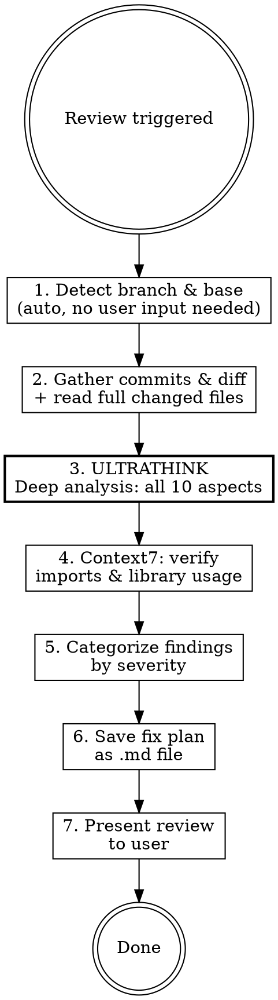

# Code Review

## Overview

Deep, opinionated code review of all commits on the current branch. Auto-detects the branch and base, reviews every change against 10 strict aspects, verifies library currency via Context7, and produces a saved fix plan.

**Core principle:** Think deeply, review thoroughly, produce actionable fixes. Every finding has a file:line, a reason, and a concrete fix.

**CRITICAL: Use extended thinking (ultrathink) for the analysis phase.** Do not rush. Depth over speed. Consider each aspect carefully against every changed file. Read full file context, not just diffs.

**Announce at start:** "Using gcc-review skill to analyze branch changes."

## When to Use

- User says "review my code", "review this branch", "check my commits"
- After completing implementation on a feature branch
- Before opening a PR — as the review gate (e.g. invoked per-unit by `/gcc-orchestrate`, or manually before `/gcc-pr`)

## Process




## Step 1: Detect Branch and Base

**This step solves the "unclear instructions" problem.** The skill auto-detects everything. No user input required for standard workflows.

```bash
# Current branch
CURRENT_BRANCH=$(git branch --show-current)

# Find base branch
for base in main dev develop main master; do
  git rev-parse --verify "origin/$base" &>/dev/null && BASE_BRANCH=$base && break
done

if [ -z "$BASE_BRANCH" ]; then
  echo "Error: Base branch not found on origin."
  exit 1
fi

# Merge base point
MERGE_BASE=$(git merge-base "origin/$BASE_BRANCH" HEAD)
```

**If on the base branch:** Stop. Tell user to switch to a feature branch.

**If multiple base candidates:** Ask user which one to use.

**If user specifies a commit range:** Use that instead of auto-detection.

## Step 2: Gather Changes

```bash
# All commits on this branch
git log --oneline $MERGE_BASE..HEAD

# Diff stats (overview)
git diff --stat $MERGE_BASE..HEAD

# Full diff
git diff $MERGE_BASE..HEAD
```

**Read every changed file in full context.** Don't review just the diff hunks. Understand the surrounding code to catch context-dependent issues like N+1 queries, missing error handling upstream, or broken assumptions from other parts of the file.

## Step 3: Deep Analysis (ULTRATHINK)

**Engage extended thinking here.** Consider each of the 10 aspects against every changed file. Cross-reference between files. Think about how changes interact.

### Aspect 1: Security

Always check for the safest path. If there's a secure and insecure way, flag the insecure choice.

- Hardcoded secrets, API keys, tokens in code or config
- SQL injection (raw queries, string interpolation in queries)
- XSS in frontend (unsanitized user input in HTML/JSX)
- Missing input validation or sanitization
- Authentication/authorization gaps on endpoints
- Path traversal, insecure deserialization
- `eval()` or dynamic code execution
- CORS misconfigurations (`*` origins)
- Disabled security features (CSRF, etc.)

### Aspect 2: Reliability & Environment Consistency

Any new configuration / environment variable MUST be declared consistently across **every** config source the project uses — cross-reference each one that applies:

- **Example / template env files** — e.g. `.env.example` and any per-environment variants (`.env.local.example`, `.env.staging.example`, `.env.production.example`).
- **Env validation / schema** — e.g. an `env:check` script, a typed env schema, or a CI env check.
- **App / runtime config that reads the var** — e.g. `next.config.*`, `app.config.*`, or the framework's config file.
- **Deployment-platform env settings** — e.g. the host's per-environment variables (Vercel/Netlify/etc.).

Also check:

- Default values are consistent across sources
- Error handling covers failure modes (what happens when a dependency/service is down?)
- Schema changes ship with a migration; destructive/enum changes use the right primitive (e.g. `ALTER TYPE` for Postgres enums)

(Adapt the specific file names / commands above to the project's actual conventions — the rule is "every new env var is declared in *all* the sources this project uses", not any one toolchain.)

### Aspect 3: Library & Framework Currency (Context7)

For every new import or dependency change:

1. Use `resolve-library-id` to find the Context7 library
2. Use `query-docs` to check the specific methods/patterns being used
3. Flag deprecated methods, outdated patterns, or newer alternatives
4. Verify usage matches current best practices

**Also check:** Touched existing code that uses outdated patterns of the same library.

### Aspect 4: DRY (Pragmatic, Not Pedantic)

Flag genuinely duplicated logic (same code 3+ places). **Do NOT flag:**

- Similar code serving different purposes
- Explicit code that's clearer than an abstraction
- Test code with repeated setup (readability > DRY in tests)

**Rule:** If a DRY abstraction makes code harder to understand, the duplication is better. Prefer simplicity over cleverness.

### Aspect 5: Composition Over Inheritance

- Flag inheritance hierarchies deeper than 2 levels
- Suggest composition when inheritance is used for code reuse (not IS-A)
- Flag mixin abuse (more than 2-3 mixins on a class)
- Prefer dependency injection over inheritance

### Aspect 6: Named Functions Over Complex Conditions

Flag and suggest extraction for:

- Conditions with 3+ boolean operators
- Nested ternaries
- Repeated condition patterns

```typescript
// Flag this
if (user.age >= 18 && user.verified && !user.banned && user.subscriptionActive) {

// Suggest this
function isEligibleUser(user: User): boolean {
  return user.age >= 18 && user.verified && !user.banned && user.subscriptionActive;
}
```

### Aspect 7: Nesting Depth

Flag code with more than 3 levels of nesting. Suggest:

- Guard clauses
- Early returns
- Extract inner logic into named functions
- Flatten with intermediate variables

### Aspect 8: Early Returns

Flag functions that use deep if/else trees instead of early returns:

```typescript
// Flag
function process(item) {
  if (item) {
    if (item.isValid()) {
      // 20 lines
      return result;
    }
  }
  return null;
}

// Suggest
function process(item) {
  if (!item) return null;
  if (!item.isValid()) return null;
  // 20 lines
  return result;
}
```

### Aspect 9: Performance Bottlenecks

- Large data processing without pagination or streaming
- Missing database indexes for queried columns
- Synchronous operations that should be async (or vice versa, per the project's conventions)
- Loading full objects when only IDs/counts are needed
- Missing caching for expensive, repeated operations
- Unbounded loops or recursion
- Large payloads without compression or chunking

### Aspect 10: N+1 Queries

The most common performance killer. Check:

- Per-row queries inside loops — any ORM / query builder (e.g. Supabase `.from().select()`, Prisma, ActiveRecord, raw SQL in a loop)
- Missing eager-loading / embedded selects when related rows are needed (e.g. Supabase `select('*, relation(*)')`, Prisma `include`, a JOIN)
- API calls inside loops without batching
- Both read AND write paths

```typescript
// N+1 — Flag this (example: a query builder inside a loop)
const users = await db.from('users').select('*');
for (const user of users) {
  const emails = await db.from('emails').select('*').eq('user_id', user.id);
}

// Batch — Suggest this (embed/join the related rows in one query)
const users = await db.from('users').select('*, emails(*)');
```

## Step 4: Categorize Findings

| Severity      | Criteria                                                                | Action Required                    |
| ------------- | ----------------------------------------------------------------------- | ---------------------------------- |
| **Critical**  | Security flaws, data loss risk, broken functionality                    | Must fix before merge              |
| **Important** | N+1 queries, performance issues, reliability gaps, missing config/env declarations | Should fix before merge   |
| **Moderate**  | Deep nesting, missing early returns, DRY violations, complex conditions | Fix in this PR or create follow-up |
| **Minor**     | Naming suggestions, small style improvements                            | Nice to have                       |

**Every finding MUST have:**

- `file_path:line_number`
- Which aspect (1-10) it violates
- What's wrong (specific)
- Why it matters (impact)
- How to fix (concrete suggestion)

## Step 5: Present Review

Present findings in conversation grouped by severity. Start with a summary:

```text
## Review Summary

**Branch:** feat/PROJ-123
**Commits reviewed:** 7
**Files changed:** 12
**Findings:** 1 critical, 3 important, 2 moderate, 4 minor

## Critical

### [C1] SQL injection in user search endpoint
- **File:** `app/api/v1/users.py:47`
- **Aspect:** #1 Security
- **Issue:** Raw f-string in SQL query
- **Impact:** Allows arbitrary SQL execution
- **Fix:** Use parameterized query with the ORM's `.filter()` / bound parameters
```

## Step 6: Save Fix Plan (auto-save, do NOT commit)

**Save the report file immediately. Do NOT ask the user for confirmation before writing.** This is the one place where the Ask → Confirm → Execute pattern is intentionally skipped — the report is local-only output, not a state mutation against shared systems.

**Path:** `docs/plans/review-<sanitized-branch>-<YYYY-MM-DD>.md`

**Sanitize the branch name first** — replace `/` with `-` (e.g. `feat/PROJ-123` → `feat-PROJ-123`).
Ticket-keyed branches with slashes are expected and valid, so this is path-sanitization, NOT
rejection: an unsanitized `/` would turn the report into a nested directory and scatter reruns
across paths. Normalizing keeps every rerun on one stable file.

Create `docs/plans/` if it doesn't exist.

**Do NOT git add, commit, or push the report file.** The report is a working artifact for the user; let them decide whether to track it. Mention this explicitly in the handoff message below.

### Handoff message after save

After writing the file, print exactly this (substituting the path):

```text
Report saved: docs/plans/review-<branch>-<date>.md (uncommitted)

Open a new session in this repo and tell it:
  "implement the fixes on the report file docs/plans/review-<branch>-<date>.md"

That session will work through the report. When fixes are committed and you've confirmed
everything is good, return here to continue the cycle (fix findings, then open the PR).
```

Do not start fixing in the current session. The new-session handoff keeps the review context separate from the fix context.

**Plan contents:**

```markdown
# Code Review Fix Plan

**Branch:** <branch>
**Date:** <YYYY-MM-DD>
**Commits reviewed:** <count>

## Summary

<2-3 sentences: overall assessment, main concerns>

**Findings:** X critical, Y important, Z moderate, W minor

---

## Critical Fixes (must fix before merge)

### C1: <title>

- **File:** `path:line`
- **Aspect:** <which of the 10>
- **Issue:** <what's wrong>
- **Fix:** <specific instructions>
- **Effort:** Small / Medium / Large

---

## Important Fixes (should fix before merge)

### I1: <title>

...

---

## Moderate Fixes (fix now or follow-up)

### M1: <title>

...

---

## Minor Fixes (nice to have)

### N1: <title>

...

---

## Recommendations

<General improvements not tied to specific findings>
```

## Common Mistakes

| Mistake                                        | Fix                                                           |
| ---------------------------------------------- | ------------------------------------------------------------- |
| Reviewing only diff hunks without file context | Read full files - context reveals N+1, missing error handling |
| Marking style issues as Critical               | Critical = security, data loss, broken functionality only     |
| Flagging DRY in test code                      | Tests prioritize readability over DRY                         |
| Missing N+1 in ORM code                        | Always check for DB/API calls inside loops                    |
| Skipping env var cross-reference               | Check ALL config sources for every new env var                |
| Not using Context7 for new imports             | Always verify methods are current, not deprecated             |
| Rushing analysis                               | ULTRATHINK - depth over speed, always                         |
| Vague findings                                 | Every finding needs file:line, what, why, how to fix          |
| Over-flagging DRY                              | Only flag when abstraction genuinely improves code            |
| Being clever with suggestions                  | Suggest the simplest fix, not the cleverest                   |

## Red Flags - Stop and Flag Immediately

- Hardcoded secrets or credentials in code
- SQL injection vectors
- Missing auth on API endpoints
- Unbounded queries without pagination
- `eval()`, `exec()`, or dynamic code execution
- CORS `*` in production config
- Disabled CSRF protection
- Direct filesystem access without path sanitization
- Secrets in git-tracked files

## Integration with Other Skills

| Skill                              | Integration Point                                                                                                    |
| ---------------------------------- | -------------------------------------------------------------------------------------------------------------------- |
| **`/gcc-orchestrate` / `/gcc-pr`** | This skill is the per-unit and pre-PR review gate. Review first, fix findings, then open the PR. |
| **verification-before-completion** | Run verification AFTER fixing review findings, before claiming done                                                  |
| **requesting-code-review**         | This skill IS the review. Use requesting-code-review only when dispatching a subagent reviewer for a second opinion. |
| **systematic-debugging**           | If review uncovers a bug, switch to systematic-debugging to investigate root cause                                   |

