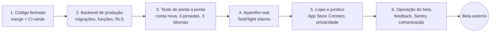

# grandma.app — plano de prontidão para beta testers

Data: 7 nov 2026 · Branch: `feat/site-look` (já contém a `main`) · Idiomas do lançamento: EN, PT-BR, ES

Objetivo: colocar o app nas mãos de beta testers sem crash, sem tela travada, sem inglês misturado,
sem dado perdido e com um caminho claro para eles reportarem problemas. Cada item tem dono:
**Claude** (faço no código/simulador), **Igor** (aparelho real, contas, lojas, decisões) ou **ambos**.

Legenda: ✅ feito · 🟡 parcial / precisa confirmar · ⬜ a fazer

---

## 1. Código fechado e integrado

| # | Item | Dono | Status |
|---|---|---|---|
| 1.1 | Revisão por jornada (ciclo, gravidez, filhos, menopausa): idioma, ícones, rótulos, lógica | Claude | ✅ |
| 1.2 | Onboarding, login, Ajustes de todas as jornadas, social, notificações, crashes de hooks | Claude | ✅ |
| 1.3 | Modo escuro, texto grande (teto 1,3×), visão da cuidadora, anéis, travamento de modais | Claude | ✅ |
| 1.4 | Tradução automática (`i18n:sync` + `i18n:check` + GitHub Action) | Claude | ✅ |
| 1.5 | Abrir PR `feat/site-look` → `main` e fazer o merge (CI: typecheck, testes, i18n) | Claude abre · Igor aprova | ⬜ |
| 1.6 | Juntar `feat/admin-feedback-labels` na `main` e publicar o admin | Igor | ⬜ |
| 1.7 | Remover código morto conhecido (`App.tsx`/`index.ts` template, `ActivityTimeline`, chaves sem uso) | Claude | ⬜ |
| 1.8 | Build de produção a partir da `main` (ícone novo, splash, todas as correções) | Igor roda | ⬜ |

## 2. Backend de produção (Supabase)

| # | Item | Dono | Status |
|---|---|---|---|
| 2.1 | Conferir que todas as migrações do app (`supabase/migrations`, última `20261102200000_paywall_flag`) e do admin (`admin/migrations`, última `0019_waitlist_place`) estão aplicadas em produção | Igor (painel) · Claude gera o checklist SQL | 🟡 |
| 2.2 | Edge functions no ar: `submit-feedback` ✅, `invite-caregiver`, `accept-invite`, `delete-account`, `export-user-data`, `notification-opened` | Igor confirma no painel | 🟡 |
| 2.3 | `translate-content` (tradutor do servidor) quebrado — hoje é só rede de segurança. Decidir: consertar ou desligar a chamada | Igor decide | ⬜ |
| 2.4 | Auditoria de RLS: toda tabela com dado de saúde só lê/escreve o dono (e cuidador autorizado nas de filhos) | Claude (leitura das migrações) | ⬜ |
| 2.5 | Flags remotas no estado de beta: chat OFF, recompensas OFF, paywall OFF, Diffuse OFF | Igor confirma no admin | 🟡 |
| 2.6 | Dados de exemplo (rotinas "Sleep Log", notificações em inglês) só na conta de teste — nunca em produção para usuários reais | Claude verifica seeds | ⬜ |
| 2.7 | Excluir conta e exportar dados funcionando de ponta a ponta | Ambos | ⬜ |

## 3. Teste de ponta a ponta no simulador (conta NOVA, sem dados)

Tudo até aqui foi testado na conta de teste cheia de dados. Beta tester chega **vazio** — estados vazios,
primeiros registros e onboarding são o que ele vê primeiro.

Para cada jornada × cada idioma (EN, PT, ES):

| # | Fluxo | Status |
|---|---|---|
| 3.1 | Cadastro com e-mail → confirmação → onboarding completo → home | ⬜ |
| 3.2 | Home vazia: textos, cards, anel, mensagem do dia | ⬜ |
| 3.3 | Primeiro registro de cada tipo (pelo dock da home e pelo "+" do calendário) | ⬜ |
| 3.4 | Editar e apagar um registro; registrar em dia passado; bloquear dia futuro | 🟡 (feito na conta cheia) |
| 3.5 | Calendário, Notas e Ajustes com poucos dados (1 dia, 1 semana) | ⬜ |
| 3.6 | Lembretes: criar, receber (no aparelho), desligar | ⬜ |
| 3.7 | Trocar de jornada, adicionar segunda jornada | ⬜ |
| 3.8 | Convidar cuidadora → aceitar convite em outra conta → visão da cuidadora | ⬜ |
| 3.9 | Enviar sugestão → aparece na caixa de Suporte do admin | ⬜ |
| 3.10 | Sair, entrar de novo, esqueci a senha, Apple/Google | ⬜ |

## 4. Aparelho real (TestFlight interno — Igor + 2–3 pessoas próximas)

| # | Item | Status |
|---|---|---|
| 4.1 | iPhone pequeno (SE / mini) e grande (Pro Max) | ⬜ |
| 4.2 | Notificações push e lembretes locais chegam na hora e no idioma certo | ⬜ |
| 4.3 | Face ID / PIN do bloqueio do app | ⬜ |
| 4.4 | Sem internet: abrir, navegar, tentar registrar (mensagem clara, nada perdido) | ⬜ |
| 4.5 | Fuso horário e virada do dia (registro às 23h55 cai no dia certo) | ⬜ |
| 4.6 | Sentry recebe um crash de teste do build de produção | ⬜ |
| 4.7 | Splash animado, ícone novo, modo escuro e texto grande do sistema | ⬜ |
| 4.8 | Android: decidir se entra no beta (precisa build EAS Android + teste em aparelho) | Igor decide |

## 5. Lojas, privacidade e jurídico

| # | Item | Dono | Status |
|---|---|---|---|
| 5.1 | TestFlight externo exige Beta App Review: descrição do beta, conta de demonstração, contato | Igor | ⬜ |
| 5.2 | App Privacy (rótulos da App Store) coerente com o que o app coleta (saúde, contato, uso) | Igor · Claude levanta o inventário | ⬜ |
| 5.3 | Política de privacidade e termos publicados (thegrandma.app) e linkados no app e na loja | Igor | 🟡 |
| 5.4 | Aviso "não é dispositivo médico / não diagnostica" visível nas telas de saúde | Claude confere | 🟡 |
| 5.5 | Consentimento (LGPD/GDPR) no onboarding, idade mínima, exclusão de conta acessível | Claude confere | 🟡 |
| 5.6 | Sentry sem PII e sem gravação de tela (já configurado) | Claude | ✅ |

## 6. Operação do beta

| # | Item | Dono | Status |
|---|---|---|---|
| 6.1 | Canal de feedback: Ajustes → Enviar sugestão → Suporte do admin | Claude ✅ · Igor testa | 🟡 |
| 6.2 | Alerta de crash do Sentry para o seu e-mail/Slack | Igor | ⬜ |
| 6.3 | Mensagem de boas-vindas para testers: o que testar, como reportar, o que ainda não existe | Claude redige · Igor envia | ⬜ |
| 6.4 | Lista de problemas conhecidos (para não virarem reports repetidos) | Claude | ⬜ |
| 6.5 | Ritmo: um build por semana, notas de versão no TestFlight | Ambos | ⬜ |
| 6.6 | Grupo de testers: tamanho, perfil (ciclo, gestantes, mães, menopausa), idiomas | Igor | ⬜ |

## 7. Decisões abertas (não bloqueiam o beta, mas precisam de dono)

- Coluna nova para condições e suplementos do onboarding do ciclo (migração).
- Campos do onboarding que nada usa: profissional de saúde e nome do parceiro (gravidez), nome do parceiro (filhos), suplementos (ciclo) — remover ou usar.
- Figurinhas novas para natação, música e dança.
- Notificações antigas: limpar as gravadas em inglês; expirar não lidas após 30 dias.
- Brechó para quem está no ciclo; figurinha do muco cervical; lembretes sincronizados entre aparelhos.

## 8. Fora do beta (V2)

Compartilhar jornada entre adultos · os outros 8 idiomas · Insights/leituras/artigos (atrás do chat) ·
chat com a Grandma · ranking e recompensas · paywall.

---

## Ordem sugerida

1. **Claude, agora:** 2.4 RLS, 2.6 seeds, 1.7 código morto, 5.4/5.5 conferências, 6.3/6.4 textos do beta,
   checklist SQL do 2.1. Depois a passada 3 inteira com conta nova nos 3 idiomas.
2. **Igor, em paralelo:** 2.1/2.2/2.5 no painel, 1.6 admin, 5.1–5.3 App Store Connect, 6.2 alertas, 6.6 grupo.
3. **Juntos:** 1.5 merge → 1.8 build → 4 no aparelho → corrigir → build → **beta externo**.
