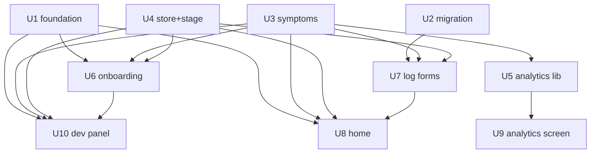

## Dependency graph

## Wave plan
| Wave | Units | Parallelism | File-set notes |
|------|-------|-------------|----------------|
| 1 | U1, U2, U3, U4 | serialize (sequential mode) | disjoint: foundation / migration / symptoms lib / store+stage lib |
| 2 | U5, U6, U7 | serialize | disjoint: analytics lib+insights / onboarding / log forms+agenda |
| 3 | U8, U9 | serialize | disjoint: home+index / analytics screen+vault |
| 4 | U10 | single | devSeed + dev-panel |

## Unit status
> Rendered from `ledger.jsonl` (`ledger.mjs render`) — do not hand-edit.

| Unit | Goal | Status | Commit | Verify | Review |
|------|------|--------|--------|--------|--------|
| U1 | Behavior foundation: JourneyMode/Behavior unions + menopause, mode color token, modeConfig entry, boot union, ModeSwitcher pill, PRIORITY | done | 853b830 | pass | advisory |
| U2 | menopause_logs table + profiles.menopause_stage/last_period_date columns (idempotent migration, RLS, indexes) | done | 6cbf5f0 | pass | advisory |
| U3 | Symptom taxonomy lib/menopauseSymptoms.ts (13 symptoms, 5 groups) + resolver | done | cc2f57e | pass | advisory |
| U4 | useMenopauseStore (stage/lastPeriodDate + hydration gate) + lib/menopauseStage.ts months-since + 12mo offer | done | bbff0c6 | pass | advisory |
| U5 | lib/menopauseAnalytics.ts pure hooks (symptom stats, vasomotor freq, logs hook) + insights.ts table switch | done | 6bb0450 | pass | pass |
| U6 | Direct onboarding: useMenopauseOnboardingStore (ephemeral) + app/onboarding/menopause/ flow + journey option | done | 989d2ab | pass | advisory |
| U7 | Symptom log sheet + saveMenopauseLog helper + agenda timeline | done | 8e097a4 | pass | advisory |
| U8 | MenopauseHome (stage hero, months counter, 12mo offer, quick-log, wisdom) mounted on home | done | 1f09ec0 | pass | advisory |
| U9 | MenopauseAnalytics screen (vasomotor, symptom stats, trends) mounted in vault slot | done | 0cac21c | pass | pass |
| U10 | Dev Panel tools + seedMenopauseData (mode button, stage picker, months scrubber, jump-to-onboarding, repairBehaviors) | done | c682a17 | pass | pass |

## Notes
- Isolation = main (user works directly on main; no end-of-run PR — commits land on main, push on completion).
- Per-wave checkpoints: pause after each wave for review.
- **Run complete (all 10 units done + gated + committed on main).** Aggregate verify GREEN (18 menopause tests pass, typecheck clean outside the concurrent kids-insights WIP). Final cross-unit review fixed the last P1 (menopause absent from `HomeJourneySwitcher`/`MyJourneyPillGrid`) in `3d15f3e`.
- **Ledger note:** U2–U10 gate/progress entries + the terminal close were reconstructed after a concurrent-session git churn (and an `argv[1]` self-append bug in the append scripts) left the working-tree ledger frozen at 18 lines. Commit SHAs, results, and findings are drawn from the committed review reports under `reports/`; timestamps are marked `reconstructed`. Validates `--closed` with 0 errors / 0 warnings. Cost floor: **$37.84**.
