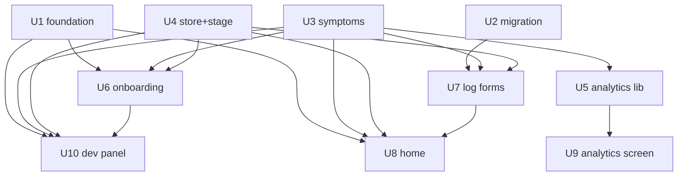

## Dependency graph

## Wave plan
| Wave | Units | Parallelism | File-set notes |
|------|-------|-------------|----------------|
| 1 | U1, U2, U3, U4 | serialize (sequential mode) | disjoint: foundation / migration / symptoms lib / store+stage lib |
| 2 | U5, U6, U7 | serialize | disjoint: analytics lib+insights / onboarding / log forms+agenda |
| 3 | U8, U9 | serialize | disjoint: home+index / analytics screen+vault |
| 4 | U10 | single | devSeed + dev-panel |

## Unit status
| Unit | Goal | Status | Commit | Verify | Review |
|------|------|--------|--------|--------|--------|
| U1 | Behavior foundation: JourneyMode/Behavior unions + menopause… | pending | — | — | — |
| U2 | menopause_logs table + profiles.menopause_stage/last_period_… | pending | — | — | — |
| U3 | Symptom taxonomy lib/menopauseSymptoms.ts (13 symptoms, 5 gr… | pending | — | — | — |
| U4 | useMenopauseStore (stage/lastPeriodDate + hydration gate) + … | pending | — | — | — |
| U5 | lib/menopauseAnalytics.ts pure hooks (symptom stats, vasomot… | pending | — | — | — |
| U6 | Direct onboarding: useMenopauseOnboardingStore (ephemeral) +… | pending | — | — | — |
| U7 | Symptom log sheet + saveMenopauseLog helper + agenda timelin… | pending | — | — | — |
| U8 | MenopauseHome (stage hero, months counter, 12mo offer, quick… | pending | — | — | — |
| U9 | MenopauseAnalytics screen (vasomotor, symptom stats, trends)… | pending | — | — | — |
| U10 | Dev Panel tools + seedMenopauseData (mode button, stage pick… | pending | — | — | — |

## Notes
- Isolation = main (user works directly on main; no end-of-run PR — commits land on main, push on completion).
- Per-wave checkpoints: pause after each wave for review.
