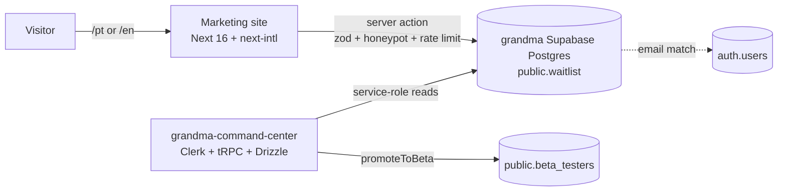

# Marketing site: real waitlist, Diffuse redesign, PT/EN

**Date:** 2026-10-30
**Status:** Approved design. Next step: implementation plan.
**Repos touched:** `v0-grandma-app` (this site) and `grandma-command-center` (admin).
**Reference only:** `grandma-app` (design tokens and copy). No changes to that repo.

---

## 1. Goal

Get the grandma.app marketing site ready to collect a real waitlist before launch:

1. **Waitlist:** the form saves signups to grandma's Supabase Postgres, and the team manages them from a new **Waitlist** pillar in grandma-command-center.
2. **Redesign:** the site moves from the old cream-paper / sticker-collage look to the app's current **Diffuse (v3)** design system. The copy is updated to the app's four live modes.
3. **Languages:** the whole site is available in English and Brazilian Portuguese.

### Success criteria

- A visitor on `/pt` or `/en` can join the waitlist. The row appears in the command center within seconds.
- Submitting an email twice shows the same success state and keeps a single row, with the original `created_at` (queue position) unchanged.
- Every page (home, pricing, privacy, terms) renders fully in both locales. No hard-coded user-facing strings remain in components.
- The site visually matches the app's Diffuse system: same fonts, palette, mode fields, hairlines and action style.
- `next build` passes in both repos, and the command center's Vitest suite passes.

### Out of scope

- Confirmation or invite emails.
- An admin UI inside the marketing site.
- Tolgee sync for site strings.
- The caregiver mode (it is only scaffolded in the app).
- Any change to the `grandma-app` repo.

---

## 2. Current state

| Area | Today |
|---|---|
| Waitlist form | `components/waitlist-faq-section.tsx` only runs `console.log`. Nothing is saved. |
| Design | Old system: Fraunces + DM Sans + Instrument Serif, cream `#F3ECD9`, stamp shadows, filled pills, sticker collage. |
| Content | "Three stages" (trying / expecting / raising). The app now ships four modes: cycle, pregnancy, kids and menopause. |
| i18n | None. All copy is hard-coded English across ~15 components and 3 sub-pages. |
| Metadata | References `/og-image.png`, which does not exist in `public/`. |

The app has made Diffuse the default (`useThemeStore` → `variant: 'diffuse'`). Its tokens live in `grandma-app/constants/theme.ts`, and the visual reference is `grandma-app/docs/design/design-system-v3.html`.

---

## 3. Architecture



### 3.1 i18n (site)

- **Library:** `next-intl`.
- **Routing:** every page moves under `app/[locale]/` with locales `en` and `pt`. `/` redirects based on `Accept-Language` (`pt*` → `/pt`, otherwise `/en`). An explicit choice is remembered in the `NEXT_LOCALE` cookie.
- **Messages:** `messages/en.json` and `messages/pt.json`, namespaced by section (`nav`, `hero`, `modes`, `meet`, `pillars`, `connections`, `memories`, `testimonials`, `waitlist`, `faq`, `footer`, `pricing`, `privacy`, `terms`, `meta`).
- **Switcher:** a `PT · EN` toggle in the navigation, set in mono type. It keeps the current path and section anchor.
- **SEO:** per-locale `generateMetadata` (title, description, Open Graph), `alternates.languages` hreflang tags for `en`, `pt-BR` and `x-default`, and a dynamic `<html lang>`.
- **Copy:** I draft the pt-BR copy, and Igor reviews it before merge. Privacy and terms are translated too. A legal check of the Portuguese versions is recommended but not blocking.
- **Guard:** a small script (`pnpm i18n:check`) fails if the two message files have different key sets.

### 3.2 Diffuse redesign (site)

**Approach:** port the Diffuse tokens to CSS variables, build a small web primitive kit that mirrors the app's primitives, then rebuild each section on top of the kit. The alternatives (swapping tokens in the current components, or copying the v3 HTML's CSS) were rejected. Swapping tokens would keep the old filled pills and stamp shadows. Copying the v3 CSS would leave a large block of loose CSS that does not fit the site's Tailwind setup.

**Tokens** (`app/globals.css`, values taken from `diffuseLightTokens` and the v3 reference):

| Group | Values |
|---|---|
| Paper | `--d-paper #F4F1E8`, `--d-paper-2 #FBFAF5`, `--d-bg-deep #EDE9DD` |
| Ink | `--d-ink #1A1916`, `--d-ink-2 #4A463E`, `--d-ink-3 #807A6E`, `--d-ink-4 #B3AC9C` |
| Lines | `--d-line rgba(26,25,22,.12)`, `--d-line-2 rgba(26,25,22,.20)`, `--d-hairline rgba(26,25,22,.55)` |
| Radius | 14 / 20 / 28 / 40. No pill radius. |
| Blur | soft 40, field 70, glass 18 |
| Shadows | `--sh-card`, `--sh-pop` only |
| Grain | feTurbulence SVG data-URI overlay, opacity 0.22 |
| Mode fields | `pre`, `preg`, `kids`, `meno`: each has stops g1–g4 plus `accent` and `accentSoft`, copied from `diffuseFields` |

These are wired into Tailwind with `@theme inline`, so components use utilities rather than hex values.

**Fonts** (`next/font/google`): Hanken Grotesk (Bold for titles, hero numbers and feeling words; Regular for body text) and Space Mono (labels, chips, numbers, dates). Fraunces, DM Sans and Instrument Serif are removed. Fonts are assigned by role, not by size, as in the app.

**Primitive kit** (`components/diffuse/`):

| Primitive | Purpose |
|---|---|
| `Display` | Bold grotesque heading, with an optional italic feeling word |
| `MonoLabel` | Uppercase, letter-spaced mono label (eyebrows, chips, data) |
| `GradientField` | Blurred four-stop generative field for a given mode |
| `Grain` | Noise overlay layer |
| `ActionRule` | Containerless primary CTA: mono label and arrow on a hairline rule |
| `TextLink` | Mono secondary link |
| `HairlineSelect` | Ring/dot selection for segmented choices (used for the mode picker) |
| `Field` | Text input with a hairline underline |
| `Card` | Paper-2 surface, radius 20/28, `--sh-card` |

Existing stickers stay, but only as icons, not as a background collage.

**Page structure (home):** Navigation → Hero → **Four modes** (replaces Three stages; adds Menopause) → Meet Grandma → Pillars → Connections → Memories → Trust strip + Testimonials → Waitlist → FAQ → Final strip → Footer. Each mode block sits on its own `GradientField`. Framer-motion stays, with slower and softer motion that respects `prefers-reduced-motion`.

**Content updates:**
- Copy that lists the three stages now lists all four modes.
- The FAQ mentions menopause.
- The FAQ answer "Is it really powered by AI?" still says "built on Claude", although commit `bc80556` removed "Powered by Claude" from the hero. Igor decides the wording during copy review.
- A real `public/og-image.png` (one per locale) is added, or the reference is removed.

**Pricing, privacy and terms** get the same tokens and primitives, as lighter text pages.

### 3.3 Waitlist write path (site)

**Table** (owned by the command center; see 3.4):

```sql
create table public.waitlist (
  id            uuid primary key default gen_random_uuid(),
  email         text not null,
  name          text,
  mode          text not null check (mode in ('pre','preg','kids','meno')),
  locale        text not null check (locale in ('en','pt')),
  notify_launch boolean not null default false,
  utm_source    text,
  utm_medium    text,
  utm_campaign  text,
  referrer      text,
  ip_hash       text,
  created_at    timestamptz not null default now(),
  updated_at    timestamptz not null default now(),
  invited_at    timestamptz,
  invited_by    text
);
-- email is stored lowercased; a plain unique constraint (not an expression
-- index) so ON CONFLICT (email) works.
alter table public.waitlist add constraint waitlist_email_key unique (email);
alter table public.waitlist add constraint waitlist_email_lower_chk check (email = lower(email));
create index waitlist_created_at_idx on public.waitlist (created_at desc);
create index waitlist_ip_hash_created_idx on public.waitlist (ip_hash, created_at desc);
alter table public.waitlist enable row level security;  -- no policies: service role only
```

A SQL function `public.waitlist_join(...) returns text` does the rate-limit check and the upsert in one round trip. Execute is granted to `service_role` only. It returns `'ok'` or `'rate_limited'`.

**Server action** (`lib/waitlist/action.ts`, `"use server"`):

1. Parse the form with zod: valid email (max 254 characters), optional name (max 80), `mode` from the enum, `locale` from the route, `notify_launch` as a boolean, and UTM and referrer values (max 200 each).
2. **Honeypot:** a hidden `company` field. If it is filled, return success without writing anything.
3. Call `waitlist_join` through `supabase.rpc(...)` with `ip_hash = sha256(WAITLIST_IP_SALT + ":" + ip)`.
   - **Rate limit:** if there are 5 or more rows with that hash in the last hour, the function returns `'rate_limited'` and the user sees a translated "try again later" message.
   - **Upsert:** on conflict on `email`, it updates `name` (only if a new one is given), `mode`, `locale`, `notify_launch` and `updated_at`. It never touches `created_at` (queue position) or first-touch UTM values.
4. Return the same success state for a new email and an existing one. The response never reveals whether an email was already on the list.

The call uses `@supabase/supabase-js` with `SUPABASE_SERVICE_ROLE_KEY`, in a `server-only` module. UTM values are read from the landing URL on the client and posted as hidden fields.

**Hero:** the hero's email field does not submit on its own. It passes the email to the main waitlist form (prefill and scroll), because a mode is required. The hero's "Trusted by 3,200+ families" counter is fabricated (it increments randomly every 8 seconds), so it is removed. Only "Built by parents, for parents." stays.

**Form UI states:** idle, submitting (button disabled, mono "saving…" label), success (translated thank-you that replaces the form), validation error (inline, per field), and server error (a single translated message plus a retry). A consent line under the button links to the localized privacy page. This covers LGPD and GDPR: the stated purpose is the invite and launch notice only.

**Environment variables (site, Vercel):** `SUPABASE_URL`, `SUPABASE_SERVICE_ROLE_KEY`, `WAITLIST_IP_SALT`.

### 3.4 Waitlist pillar (grandma-command-center)

This follows the "Adding a pillar" convention in that repo's `CLAUDE.md`.

- **Migration:** `migrations/0018_waitlist.sql` holds the SQL from 3.3 and is applied against `DATABASE_URL` (the transaction pooler). The Drizzle `waitlist` table is added to `db/schema/center.ts`.
- **Router** `server/routers/waitlist.ts`, registered in `server/routers/index.ts`:

| Procedure | Gate | Behaviour |
|---|---|---|
| `stats` | `protectedProcedure` | Total, last-7-day count, signups per day (90 days), and breakdowns by mode and locale. Aggregates only, no emails. |
| `list` | `piiProcedure` | Paginated rows. Filters: mode, locale, date range, invited/not invited, email search. Each row has `signedUp`, from a `lower(email)` join to `auth.users` (same pattern as `beta.list`). Writes an audit entry. |
| `exportCsv` | `piiProcedure` | CSV of the current filter. Writes `writeAudit({ action: 'waitlist.export', meta: { filter, count } })`. |
| `promoteToBeta` | `adminProcedure` | For the selected ids: insert into `beta_testers` (`platform: 'both'`, `note: 'from waitlist'`; skip if the email is already there), then set `waitlist.invited_at` and `invited_by`. Audited. |

- **UI:** `app/(app)/waitlist/page.tsx` plus a client component. Uses the command center's own "Central" skin, not Diffuse. Stat tiles, a signups-per-day chart (Recharts/Tremor, following the `dataviz` rules), and a table with row selection, filters, an "Export CSV" button and a "Promote to beta" button. Viewers see only the stats. Admins see the table.
- **Sidebar:** add `/waitlist` to `PILLARS` and `READY` in `components/CommandCenterSidebar.tsx`.

---

## 4. Error handling

| Failure | Behaviour |
|---|---|
| Invalid input | Translated field errors from zod messages mapped to i18n keys. Nothing is written. |
| Honeypot filled | Silent success. Nothing is written. |
| Rate limit hit | Translated "try again later" message. Nothing is written. |
| Supabase unreachable or error | Logged server-side with no PII (email masked). The user sees the generic error and can retry. |
| Missing env vars | The action throws a clear `<NAME> is not set` error on first use. It never writes partially or fails silently. The pre-launch end-to-end check against the production build confirms they are set. |
| Command center DB error | Standard tRPC error toast. Export and promote are all-or-nothing transactions. |

---

## 5. Testing

**Site**
- Unit tests (Vitest, newly added): the zod schema (valid and invalid cases), the honeypot path, the rate-limit decision, and the upsert payload shape. Supabase is mocked.
- `pnpm i18n:check`: both message files have identical keys.
- `next build` passes.
- Visual check: screenshots at 390, 768 and 1280 px for `/en` and `/pt` (home, pricing), compared side by side with `design-system-v3.html`.
- Manual end-to-end against the dev database: submit, resubmit the same email, and confirm a single row with the original `created_at`.

**Command center**
- Vitest: the row transform, the CSV serializer (escaping), and the filters-to-SQL builder.
- A throwaway script against the live DB verifies the migration and `promoteToBeta`, per the repo convention.
- `pnpm typecheck`, `pnpm test` and `pnpm build` pass.

---

## 6. Rollout order

1. Command center: migration plus Drizzle schema. The table exists, and nothing writes to it yet.
2. Site: i18n routing and message extraction, keeping the current visuals. Ship-safe checkpoint.
3. Site: Diffuse tokens, fonts and the primitive kit.
4. Site: section-by-section rebuild with the four-mode content.
5. Site: waitlist server action and form states, with env vars set on Vercel.
6. Command center: Waitlist pillar (router, UI, sidebar).
7. Igor reviews the pt-BR copy, then merge and deploy.

## 7. External dependencies

- The Supabase MCP connector is not authorized in this environment. The migration is applied by running the SQL against `DATABASE_URL` from the command center (its usual flow), or Igor authorizes the connector on claude.ai.
- Env vars must be added to the site's Vercel project.
