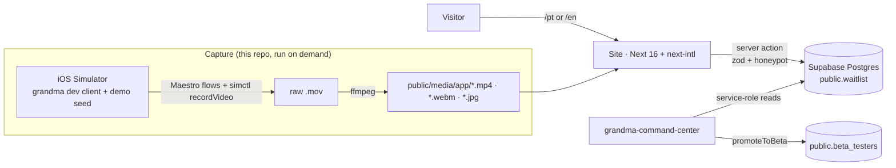

# grandma.app waitlist site: Brazil first, then the US

**Date:** 2026-10-30 (revision 2, same day)
**Status:** Draft for Igor's review. Supersedes revision 1 (Hanken Bold display, full marketing site with pricing).
**Repos touched:** `v0-grandma-app` (this site, including the app-capture scripts) and `grandma-command-center` (admin).
**Reference only:** `grandma-app` (design system, app build, demo seed). No changes to that repo.
**Visual reference:** `docs/mockups/2026-10-30-diffuse-site-and-waitlist.html` (approved direction: real Diffuse v3). Its section layout is superseded by §3.2 below.

---

## 1. Goal

For now the site has one job: **collect a waitlist for the launch, Brazil first and the US next.** Everything on the page either explains the app in one glance or leads to the form.

1. **Waitlist:** signups are saved to grandma's Supabase Postgres with the person's country, and the team manages them from a **Waitlist** pillar in grandma-command-center (filter by country, export, promote to beta).
2. **Real app, not drawings:** every app image on the site is a short looping video or still recorded from the real app in the iOS Simulator, with demo data, in both languages.
3. **Design:** the app's actual Diffuse v3 system (Hanken Grotesk Bold display, Hanken Grotesk body, Space Mono labels, generative fields, glass panels).
4. **Languages:** Brazilian Portuguese and English, with the same content.

### Success criteria

- In under five seconds a visitor understands three things: this is a waitlist, Brazil opens first, then the US.
- The form is visible in the first screen on desktop and one scroll away on mobile.
- A signup on `/pt` or `/en` appears in the command center within seconds, with the right country.
- Submitting the same email twice keeps one row and the original `created_at` (queue position).
- Every app image on the site comes from the capture pipeline (§3.5). No mock app screens.
- `next build` passes in both repos, and the command center's Vitest suite passes.

### Out of scope

- Pricing page and prices on the site (removed until launch).
- Confirmation or invite emails.
- An admin UI inside the site.
- Tolgee sync for site strings.
- The caregiver mode (scaffold only in the app).
- Any change to the `grandma-app` repo. The capture flows live in this repo and drive the installed app from outside.

---

## 2. Current state

| Area | Today |
|---|---|
| Waitlist form | `components/waitlist-faq-section.tsx` only runs `console.log`. Nothing is saved. |
| Hero | Second email form (also `console.log`) and a fabricated "Trusted by 3,200+ families" counter that increments randomly. |
| Design | Old cream-paper / sticker system. The app now ships Diffuse v3 as default. |
| App images | Hand-drawn mock screens inside phone frames. |
| Content | Three stages; the app ships four modes (cycle, pregnancy, kids, menopause). |
| Pages | Home, pricing, privacy, terms. English only. |
| App capture | `grandma-app/.maestro/README.md` describes screenshot flows, but the flow files were never committed. No simulator currently has the app installed. |

Notes from the app repo:
- The Diffuse display font in `constants/theme.ts` is temporarily swapped to Hanken Grotesk Bold (commit `5f06c35`, marked "PREVIEW SWAP"). The design-system HTML still shows Cormorant Garamond, but **Igor decided on 2026-10-30 that the bold sans is grandma's real, current display font**; the app's "PREVIEW SWAP" comment is outdated. The site follows the app: Hanken Grotesk Bold / Bold Italic.
- The app has a Dev Panel (`app/dev-panel.tsx`) with demo seeding per mode (`seedAllData`, `seedMenopauseData`, …), a mode switch, and direct routes (Grandma talk, Insights, onboarding). It has in-app language switching (`store/useLanguageStore.ts`).
- `npm run eas:install:sim` installs the latest EAS simulator build without a local compile.

---

## 3. Design

### 3.1 Architecture



### 3.2 Page structure (home, lean)

| # | Section | Content | Visual |
|---|---|---|---|
| — | Nav | Logo (heart-eye) + "grandma", `PT · EN`, "Join the waitlist →". No other links. | Transparent, blurred paper when scrolled |
| 1 | **Hero** | Mono status row: `WAITLIST OPEN · BRASIL FIRST · THEN US`. Headline (PT: "Com você em cada *capítulo.*"). One-line lede. **The form itself** (email + country + chapter + submit) on desktop; on mobile the email field and button, with the rest of the form expanding inline. | Real app video in a phone frame: the onboarding journey picker → home |
| 2 | **Launch** | Three steps on a hairline timeline: `01 Join the list` → `02 Brasil · first invites` → `03 United States · next`. One sentence each. The visitor's own country is highlighted. | Choice-timeline ring nodes from v3 |
| 3 | **Four chapters** | Four field cards (Cycle, Pregnancy, Kids, Menopause): mono chapter label, Hanken Bold title, one sentence. Each card plays that mode's home-screen loop. | Field cards + phone videos |
| 4 | **Grandma** | "Meet *Grandma.*" plus two sentences and the five trait chips. | Real chat video (Grandma talk) |
| 5 | **FAQ** | Four questions: when it launches (BR → US), what it costs (free to start, Premium optional, no numbers), privacy, who it's for (four chapters). | Hairline rows |
| — | Final strip + footer | "Take your time. *We'll be here.*" + CTA. Footer: privacy, terms, support email, language. | Kids field |

Removed from the current site: pillars grid, connections, memories, testimonials, trust strip, pricing page and nav link. Privacy and terms stay (the consent line links to privacy).

### 3.3 Visual system (real Diffuse v3)

Tokens and components are copied from `grandma-app/docs/design/design-system-v3.html`, not from `constants/theme.ts` (see the font note in §2).

- **Fonts:** Hanken Grotesk Bold (700) for display, with italic "feeling words" in Bold Italic (the app's `diffuseFont`; Igor's decision 2026-10-30); Hanken Grotesk 300–600 for reading; Space Mono 400/700 for labels and data. Italic "feeling words" are rendered in `--ink-2` (grey), or in the mode accent where the app does (e.g. "sees you.").
- **Tokens:** paper `#F4F1E8`, ink ramp `#1A1916 → #B3AC9C`, lines `.12 / .20 / .55`, radius 14/20/28/40, `--sh-card`, `--sh-pop`, grain (soft-light, 0.22 page / 0.30 field), mode fields `pre / preg / kids / meno` with g1–g4 + accent (values from `diffuseFields`).
- **Components** (`components/diffuse/`):
  - `GradientField`: the v3 `.gfield` engine (four radial gradients, blur 46px, saturate 1.14, grain overlay).
  - `SectionHead`: hairline top rule, mono number, Hanken Bold h2 with an italic part.
  - `FieldCard`: the v3 `.bcard` (chapter label, swatch dots, big bold-sans title, optional glass panel).
  - `Glass`: the frosted inner panel.
  - `ActionRule`: containerless mono label + arrow on a hairline (primary CTA).
  - `GlassPill`: the v3 `.gradpill` gradient-glass button (used once, in the final strip).
  - `Chip`: mono pill, hairline ring + bold when selected.
  - `BloomPicker`: the onboarding journey picker (four soft blooms, mono chapter + bold-italic name), used for the mode question in the form; keyboard-operable radio group.
  - `UnderlineField`: bare underline input with a mono label.
  - `AppVideo`: phone frame + `<video autoplay muted loop playsinline>` with a poster image; shows the poster only when `prefers-reduced-motion` is set.
  - `Mark`: the heart-eye SVG from `Onboarding.html`, blink + heartbeat animation, still under reduced motion.

### 3.4 i18n

Unchanged from revision 1, minus pricing:
- `next-intl`, routes `/en` and `/pt` (`localePrefix: 'always'`), `Accept-Language` detection with a `NEXT_LOCALE` cookie, `PT · EN` switch, hreflang (`en`, `pt-BR`, `x-default`), localized metadata and Open Graph images.
- Messages in `messages/en.json` and `messages/pt.json`; a Vitest check fails if the key sets differ.
- PT glossary (from the app's `lib/i18n/pt-BR.ts`): Grandma in prose = "a Vovó"; brand = "grandma.app"; modes = Ciclo, Gravidez, Filhos, Menopausa; "você".
- Media is localized too: `/pt` plays the PT app recordings, `/en` the EN ones (§3.5).

### 3.5 App capture pipeline (new)

Lives in this repo under `scripts/capture/`. Run on demand when the app changes.

**Prerequisites (one-time, per machine):**
1. Booted iOS Simulator (iPhone 16 Pro or 17 Pro size, status bar overridden to 9:41 / full battery via `xcrun simctl status_bar`).
2. Dev client installed: `cd grandma-app && npm run eas:install:sim` (latest EAS simulator build). If none exists, `npm run eas:build:sim` first.
3. Metro running in `grandma-app` (`npm start`).
4. **Igor signs in once** with a dedicated demo account (not a real user). The capture flows never type credentials.

**Flows** (`scripts/capture/flows/*.yaml`, Maestro, appId `co.sauceroom.grandma`):
- `00-setup.yaml`: open Dev Panel → `seedAllData` → set language (run once per language).
- One flow per shot. Each starts `simctl io booted recordVideo`, drives the app, then stops recording.

**Shot list** (×2 languages = 16 clips):

| Shot | Mode | What happens on screen | Used in |
|---|---|---|---|
| `onboarding-picker` | — | Journey picker: blooms, tap one, continue | Hero |
| `home-pre` | Cycle | Home: cycle ring, scroll to today's log | Chapters |
| `home-preg` | Pregnancy | Home: week card, baby size, scroll | Chapters |
| `home-kids` | Kids | Home: child switcher, today's wins, scroll | Chapters |
| `home-meno` | Menopause | Home week strip, open quick log, tap a symptom | Chapters |
| `talk` | Kids | Grandma talk: question appears, answer streams | Grandma |
| `insights-pre` | Cycle | Insights screen scroll | Spare / OG |
| `calendar-meno` | Menopause | Calendar with day icons | Spare |

**Encoding** (`scripts/capture/encode.sh`): trim to the action (≤ 8 s), crop out the simulator chrome, scale to 720 px wide, 30 fps, no audio; output `public/media/app/<lang>/<shot>.mp4` (H.264, `-crf 28`, `+faststart`), `.webm` (VP9) and `.jpg` poster (first meaningful frame). Target ≤ 1.5 MB per clip.

**Data hygiene:** demo account only; names in the seed are fictional; no real user data, emails or notifications appear in any frame. Igor reviews the 16 clips before they ship.

### 3.6 Waitlist data

Revision 1's table plus a `country` column:

```sql
country text not null default 'OTHER' check (country in ('BR','US','OTHER'))
```

- **Default in the form:** from Vercel's `x-vercel-ip-country` request header (`BR` → Brasil, `US` → United States, anything else → Other). Visitors can change it. If the header is missing, `/pt` defaults to Brasil and `/en` to Other.
- `waitlist_join(...)` gains `p_country text`; on conflict it updates `country` like the other preferences.
- Everything else from revision 1 stays: lowercased unique `email`, `waitlist_join` with honeypot + rate limit (5 signups / IP hash / hour), RLS on with no policies, service-role writes from a server action, the same response for new and existing emails, a consent line linking to privacy.

**Form fields, in order:** email · country (three chips: Brasil / United States / Other) · "Where are you *right now?*" (bloom picker, four chapters) · name (optional) · launch-notice checkbox · submit. Success state: the heart-eye mark + "You're on the *list.*" + where they are: "We'll write when invites open in Brasil."

### 3.7 Waitlist pillar (grandma-command-center)

Revision 1 §3.4, plus:
- `stats` adds `byCountry`; a "By country" tile replaces "By language" as the first breakdown.
- `list` / `exportCsv` filter by `country`; the table gets a Country column; CSV gets a `country` column.
- Migration `0018_waitlist.sql` includes the `country` column and the `p_country` parameter from the start.

---

## 4. Error handling

| Failure | Behaviour |
|---|---|
| Invalid input | Translated field errors; nothing written. |
| Honeypot filled | Silent success; nothing written. |
| Rate limit hit | Translated "try again later"; nothing written. |
| Supabase error | Logged server-side with the email masked; generic translated error with retry. |
| Missing env vars | Clear `<NAME> is not set` error on first use; checked in the pre-launch end-to-end run. |
| Geo header missing | Country defaults by locale (§3.6); the visitor can still change it. |
| Video fails to load or reduced motion | Poster image is shown; layout does not shift (fixed aspect ratio). |
| Command center DB error | Standard tRPC error toast; export and promote are all-or-nothing. |
| Capture flow can't find a label | That shot fails and the run continues; the failure is listed at the end. |

---

## 5. Testing

**Site:** Vitest for the zod schema (including `country`), IP hashing, submit core, message-key parity; `next build`; screenshots at 390 / 768 / 1280 for `/pt` and `/en`; Lighthouse mobile accessibility ≥ 95 and LCP < 2.5 s with videos (posters as LCP, videos lazy below the fold); manual end-to-end signup against dev DB (new email, repeat email, rate limit, country default from a spoofed header in dev).

**Capture:** dry run of every flow; Igor reviews all 16 clips; each encoded file ≤ 1.5 MB.

**Command center:** Vitest for filters (including country), CSV escaping and formula guard, router gates; live verification script for `waitlist_join` (including `p_country`) and promote; `typecheck`, `test`, `build`.

---

## 6. Rollout order

1. Command center: migration (with `country`) + Drizzle schema + verification script.
2. Capture: install dev client, Igor signs in to the demo account, write flows, record, encode, Igor reviews clips.
3. Site: i18n routing and messages.
4. Site: Diffuse v3 foundation (tokens, fonts, components).
5. Site: lean home (hero with form, launch timeline, chapters, Grandma, FAQ), privacy and terms; remove pricing.
6. Site: waitlist server action with country, form states.
7. Command center: Waitlist pillar with country.
8. Igor reviews PT copy and clips → merge CC first, then the site.

## 7. Needs from Igor

- A demo account for the app (email + password kept out of the repo), signed in once on the simulator.
- Review of the 16 clips and of the PT copy.
- Vercel env vars for the site: `SUPABASE_URL`, `SUPABASE_SERVICE_ROLE_KEY`, `WAITLIST_IP_SALT`, `NEXT_PUBLIC_SITE_URL`.
- The Supabase connector is not authorized in this environment; the migration runs through the command center's `DATABASE_URL`.
