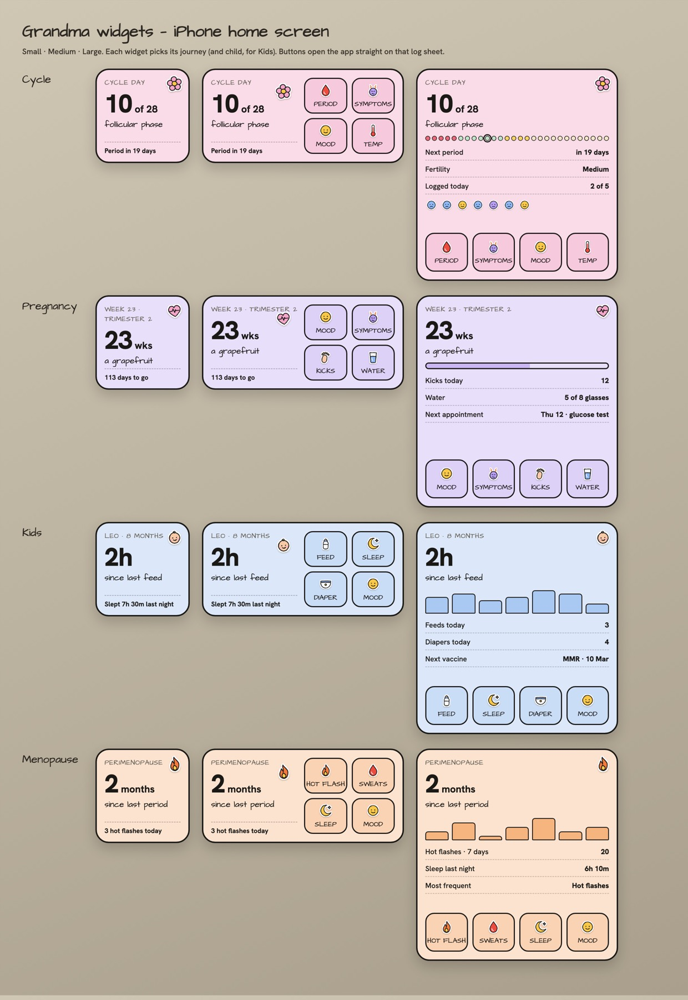

# Home-screen widgets and icon shortcuts — design

**Date:** 2026-11-09
**Status:** design approved in conversation; spec awaiting review
**Ships in:** build 19 (with the regional age rules), before the first App Store submission



## Goal

People can see where they are in their journey and start a log from the phone's home screen, on iOS and Android, without opening the app first and hunting for the right screen.

**Success looks like:**
- A widget of any size shows the right numbers for the chosen journey (and child), and they are still correct after midnight, even if the app was not opened.
- Tapping a log button in a widget opens the app directly on that log's sheet, in the right journey and for the right child.
- Long-pressing the app icon offers the 3–4 most common logs for the active journey.

## Decisions taken

| Question | Decision |
|---|---|
| What can a widget do? | Show the journey's status and metrics (more as the widget grows) and offer log buttons. |
| What does a log button do? | Opens the app on that log's sheet. Nothing is saved from the widget itself. |
| Several journeys? | Each widget is configured to one journey (and, for kids, one child). People add one widget per journey if they want all of them. |
| Privacy | Show everything. There is no "hide details" mode in v1. |
| Data approach | **Snapshot (approach A).** The app writes a small JSON snapshot to shared storage; widgets only read it. Widgets never talk to Supabase. |
| Pregnancy visual | The baby-size fruit image appears in the pregnancy widget. |
| Platforms | iOS (WidgetKit) and Android (app widgets) both ship. Android gets its first-ever build for this. |

## Content by journey and size

Text follows the app's language (en, pt-BR, es). Numbers below are examples.

### Cycle
- **Small:** "Day 10 of 28 · follicular phase" / "Period in 19 days".
- **Medium:** small content plus buttons **Period, Symptoms, Mood, Temp**.
- **Large:** medium content plus a 28-dot phase strip with today marked, the next period date, the fertile window, a "logged today" line, and mood faces for the last 7 days.

### Pregnancy
- **Small:** fruit image, "23 wks · a grapefruit" / "113 days to go".
- **Medium:** small content plus buttons **Mood, Symptoms, Kicks, Water**.
- **Large:** medium content plus a progress bar to the due date, kicks today, water today against the target, and the next appointment.

### Kids (one chosen child)
- **Small:** "Leo · 8 months" / "2h since last feed" / "slept 7h30".
- **Medium:** small content plus buttons **Feed, Sleep, Diaper, Mood**.
- **Large:** medium content plus feed bars for the last 7 days, feeds and diapers today, and the next vaccine.

### Menopause
- **Small:** "2 months since last period · perimenopause" / "3 hot flashes today".
- **Medium:** small content plus buttons **Hot flash, Sweats, Sleep, Mood**.
- **Large:** medium content plus hot-flash bars for the last 7 days, last night's sleep, and the most frequent symptom.

### States that apply to every widget
| State | What the widget shows | Tap goes to |
|---|---|---|
| Signed out (or snapshot wiped) | "Sign in to Grandma" | App sign-in |
| Journey not enrolled | "Start <journey> in Grandma" | Journey onboarding |
| Enrolled but no data yet | The journey's empty line, for example "Log your last period to see your cycle"; log buttons still shown | The log sheet |
| Child removed or no longer shared | "Pick a child" (long-press, then Edit widget, to choose) | Kids home |
| Normal | Content above | Body opens the journey's home; buttons open the log sheet |

- Caregivers see the kids shared with them, the same set the app shows.
- Minors never see intercourse or sex-drive content: none of the buttons above use them, and `snapshot.ts` drops them from the "logged today" line using `MINOR_HIDDEN_CYCLE_LOGS`.

### Icon shortcuts (long-press on the app icon)
The 3–4 log types for the **active** journey (the same as that journey's medium-widget buttons, kids for the active child), plus "Open calendar". They update whenever the active journey changes.

## Architecture

```
App (React Native)                          Shared storage                 Widgets
──────────────────                          ──────────────                 ───────
stores + Supabase data
   │
   ▼
lib/widgets/snapshot.ts  (pure)  ──JSON──▶  iOS: App Group UserDefaults  ─▶ targets/widget/ (SwiftUI, WidgetKit)
   │                                        Android: SharedPreferences    ─▶ widgets/android/ (react-native-android-widget)
lib/widgets/publish.ts   (writes + asks widgets to reload)
   │
expo-quick-actions  ◀── active journey's log list

Widget/shortcut tap ──▶ grandma-app://log/<journey>/<type>?child=<id>
                        ──▶ app/log/[journey]/[type].tsx
                        ──▶ switch journey/child, open the journey home, open that log's sheet
```

### Units

| Unit | Responsibility | Depends on |
|---|---|---|
| `lib/widgets/snapshot.ts` | Pure function: app state in, `WidgetSnapshot` out. All wording is already translated here. Fully unit-tested. | Existing domain helpers (cycle phase, gestational week and fruit, kid age, menopause stage) |
| `lib/widgets/publish.ts` | Serialises the snapshot, writes it to shared storage, asks iOS/Android to reload the widgets, updates the icon shortcuts. Debounced. | `snapshot.ts`, native bridges |
| `lib/widgets/deepLinks.ts` | Builds and parses `grandma-app://log/<journey>/<type>?child=<id>`. Unit-tested both ways. | none |
| `app/log/[journey]/[type].tsx` | Route that applies a parsed link: sets the journey (and child), navigates to that home, and hands the log type to a small pending-intent store that the home consumes once to open the sheet. | `deepLinks.ts`, `useModeStore`, `useBehaviorStore`, `useChildStore` |
| `targets/widget/` | Swift WidgetKit extension, built with `@bacons/apple-targets`. Reads the snapshot and renders S/M/L. Configurable journey and child (App Intent). | App Group |
| `widgets/android/` | `react-native-android-widget` task handler and layouts for S/M/L, plus a configuration screen for journey and child. | SharedPreferences |

### The snapshot

One JSON document with one entry per enrolled journey; kids has one entry per visible child. Each entry holds:
- **Already-rendered strings** in the app language (the widget does not translate).
- **Anchor dates** so the widget can recompute date-dependent values itself: cycle start date and length, due date, child's birth date, last-period date for menopause, and timestamps of the last feed and sleep.
- **Day-bound series**: 7-day mood, feed and hot-flash counts, and today's counts, each tagged with the day they were computed for.
- **Log buttons**: type id and label.
- Pregnancy only: the path of the fruit PNG in shared storage.

The widget recomputes the values that change with the clock (cycle day, weeks, days to go, child age, "2h since last feed") from the anchors on each timeline refresh, including midnight. Today's counts reset to zero at midnight when the stored "computed for" day is in the past.

### When the snapshot is written
- On app start, after journeys are restored.
- After any log is saved, edited or deleted.
- When the app goes to the background.
- On a journey switch, child change, language change, or settings change that affects the content (cycle length, due date).
- On logout the snapshot is **wiped**, so widgets show "Sign in to Grandma".

### Fruit image
The pregnancy fruit is drawn by the app's existing fruit illustration, captured once per week with `react-native-view-shot` as a PNG into shared storage. The snapshot points at that file. If the file is missing, the widget shows the text without the image.

## Platform details

**iOS**
- New target `co.sauceroom.grandma.widget` and an App Group (for example `group.co.sauceroom.grandma`) on both the app and the extension.
- Configuration is an App Intent with a journey picker and a child picker (shown only for kids), with the choices read from the snapshot.
- Timeline: an entry now, plus one at the next midnight; the app also forces reloads after writes.
- New native libraries: `@bacons/apple-targets`, `expo-quick-actions`, `react-native-view-shot`.

**Android**
- `react-native-android-widget` with three size layouts and a configuration activity for journey and child.
- Package `com.grandmacoder.grandmaapp` (already in `app.json`). First Android build: a development APK for the emulator to test the widgets.
- Midnight refresh through the library's update interval plus a reload after every snapshot write.

**Both:** all of this needs a new native build. Nothing works in the current dev client.

## Error handling
- A missing or unreadable snapshot is treated as signed out ("Sign in to Grandma"), never as a crash or a blank widget.
- A snapshot from an older app version: the snapshot carries a `version`; widgets that don't recognise it show "Open Grandma to refresh".
- A deep link to an unknown journey or type opens the app home. A link to a child the user no longer sees opens the kids home without a child preselected.
- A failure to publish is logged to Sentry and never blocks the save that triggered it.

## Testing
- **Unit:** `snapshot.ts` for each journey × {normal, empty, minor, caregiver, missing child}; `deepLinks.ts` round-trip and malformed input; midnight rollover of the "computed for" logic.
- **Simulator / emulator:** add every size of every journey, check the PT and ES text in the small size, tap each button and confirm the right sheet opens, sign out and confirm the wipe, change the clock past midnight.
- **Device only:** widget refresh cadence and battery behaviour, icon shortcuts on a real home screen.

## Rollout
1. **Shared JS base:** snapshot, publish, deep links and route, fruit capture, icon shortcuts.
2. **iOS widget** (Swift) with configuration and App Group.
3. **Android widget.**
4. **Build 19** carries the age rules, widgets and shortcuts, and is attached to App Store version 1.0.0. Build 18 can go to TestFlight beta in the meantime.

No EAS build, App Store change or TestFlight submission happens without Igor's explicit OK.

## Out of scope (v1)
- Saving a log directly from the widget (interactive buttons).
- A privacy mode or a hidden-details option.
- Apple Watch, Lock Screen and StandBy widgets, and Live Activities.
- Widgets for community, chat or the garage.

## Risks
- **Long PT/ES strings in the small widget:** keep the strings short, scale the text down, and check on a 375 pt screen.
- **Extension signing:** the new bundle id and App Group must be registered before EAS can sign build 19.
- **Stale data:** if the app isn't opened for days, counts reset at midnight but new logs from a caregiver won't appear until the app runs. This is accepted for v1.
